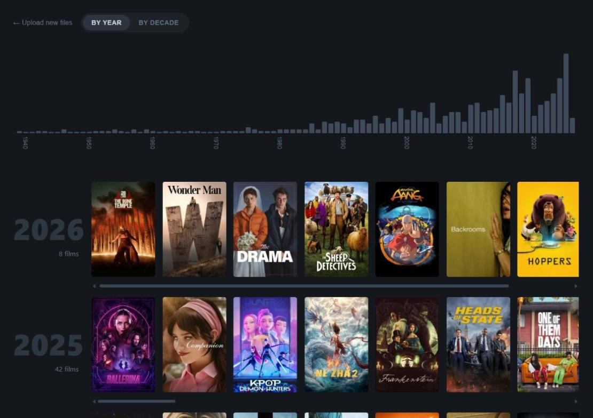
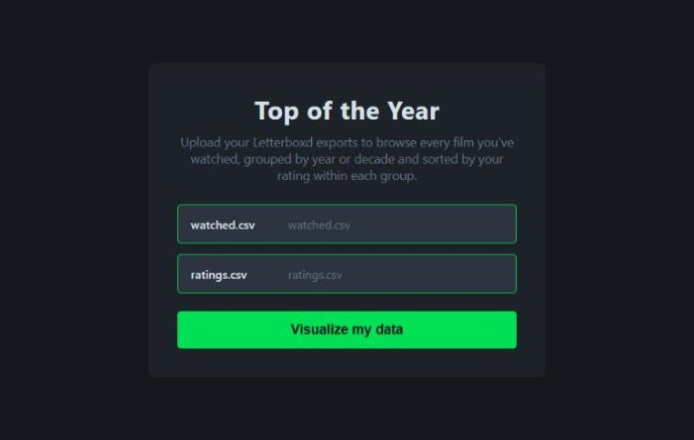
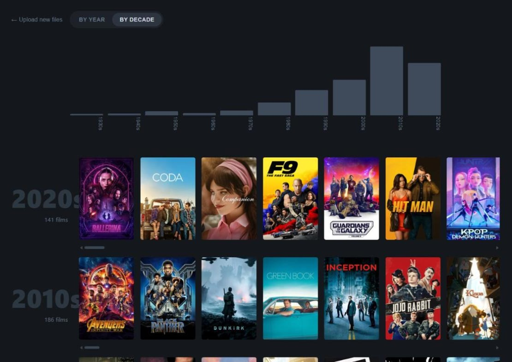
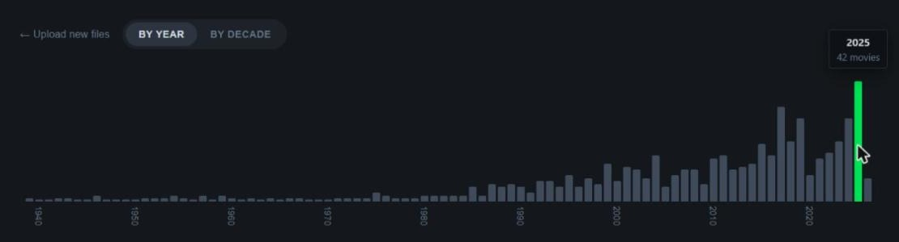
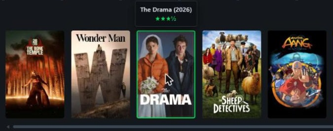
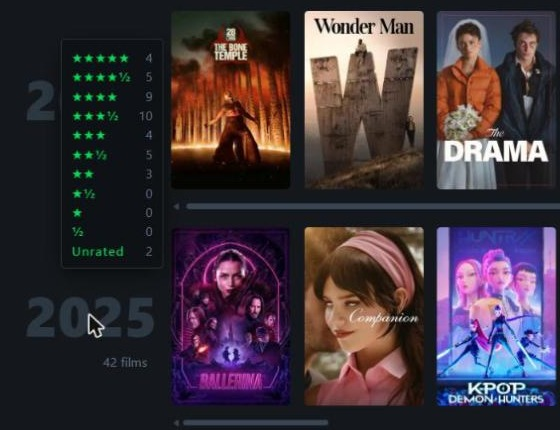

<div align="center">


# Letterboxd Top of the Year

**Turn your Letterboxd history into a poster wall: every film you've watched, grouped by release year or decade and ranked by your own ratings.**

[](https://letterboxd-top-of-the-year.vercel.app/)


### [▶ Try it live](https://letterboxd-top-of-the-year.vercel.app/)

<br />



</div>

<br />

## ✨ Features

- **Year or decade view.** Every film you've logged on Letterboxd goes into a row for its release year or decade, newest first. Years with nothing in them between your oldest and newest film still show up, so gaps in your history are visible.
- **Your favourites first.** Each row is sorted by your rating, highest first. Unrated films go last, and ties are broken alphabetically.
- **Interactive histogram.** A bar chart of films per year or decade sits at the top. Hover a bar to see the count, click it to jump to that row.
- **Rich tooltips.** Hover a poster to see its title, year and star rating. Hover a year to see how you rated that year's films.
- **Real posters.** Artwork is fetched from TMDB and fills in progressively as results arrive. Every lookup is cached, so later visits are instant.
- **Remembers your list.** Your library stays in the browser between visits, so you upload once.
- **Private by design.** Your CSVs never leave your machine. See [Privacy](#-privacy).

## 🚀 How to use it

### 1. Export your data from Letterboxd

On Letterboxd, go to **Settings → Data → Export your data**. You'll get a `.zip`; unzip it and find `watched.csv` and `ratings.csv`.

> Don't have a Letterboxd account handy? Use the sample exports in [`example-data/`](example-data/).

### 2. Upload both files

Open the [app](https://letterboxd-top-of-the-year.vercel.app/), pick `watched.csv` and `ratings.csv`, and hit **Visualize my data**.

<p align="center">
  
</p>

### 3. Explore

Scroll through the rows, swipe each one sideways, and switch between **By Year** and **By Decade** at the top.

<table>
  <tr>
    <td width="50%" valign="top">
      
      <p align="center"><b>By Year</b>: one row per release year</p>
    </td>
    <td width="50%" valign="top">
      
      <p align="center"><b>By Decade</b>: the bigger picture</p>
    </td>
  </tr>
</table>

## 🔍 Up close

<p align="center">
  
  <br />
  <sub><b>Histogram</b>: hover a bar for the year and its film count; click it to scroll to that row.</sub>
</p>

<table>
  <tr>
    <td width="55%" valign="top">
      
      <p align="center"><sub><b>Poster tooltip</b>: title, year and your rating.</sub></p>
    </td>
    <td width="45%" valign="top">
      
      <p align="center"><sub><b>Rating breakdown</b>: how you rated that year's films, half-star by half-star.</sub></p>
    </td>
  </tr>
</table>

## 🔒 Privacy

- Your CSVs are **parsed entirely in your browser**. They are never uploaded anywhere.
- The parsed list is saved in your browser's `localStorage`, so reloads skip the upload step. Click **← Upload new files** to clear it.
- The only network calls are poster lookups: a film's **title and year** go to a small proxy at `/api/tmdb`, which forwards them to TMDB's search API. Nothing else about your library (ratings, watch dates, account) is sent.

## 🛠 How it works

```text
watched.csv ─┐
             ├─▶ csv.ts ──▶ storage.ts ──▶ group.ts ──▶ React UI
ratings.csv ─┘   parse &     localStorage   bucket by       │
                 merge by    cache          year / decade,  │ title + year
                 Letterboxd                 sort by rating  ▼
                 URI                                     tmdb.ts ──▶ /api/tmdb ──▶ TMDB
                                                         (cached,     (serverless proxy,
                                                          8 at once)   holds the API key)
```

1. **Parse & merge** (`src/lib/csv.ts`): both exports are parsed with PapaParse and joined on the `Letterboxd URI`. `watched.csv` is the master list; `ratings.csv` adds the scores.
2. **Persist** (`src/lib/storage.ts`): the merged list is saved to `localStorage`. Posters are not stored with it; they're re-resolved from the poster cache on load.
3. **Group** (`src/lib/group.ts`): films are bucketed by year or decade, empty years in between are filled in, and each group is sorted by rating.
4. **Posters** (`src/lib/tmdb.ts`): looked up through the `/api/tmdb` proxy with bounded concurrency, filling cards in as they resolve. Every result, misses included, is cached.
5. **Proxy** (`api/tmdb.js`): a Vercel Function that signs requests with a server-side `TMDB_API_KEY`, so the key is never shipped to the browser. It only allows TMDB's movie and TV search endpoints.

<details>
<summary><b>Project structure</b></summary>

```text
.
├── api/                  # Vercel serverless function (TMDB proxy)
│   ├── tmdb.js           #   endpoint: /api/tmdb
│   └── _tmdb.js          #   shared proxy logic (also used by the Vite dev server)
├── example-data/         # sample Letterboxd exports to try the app with
├── public/               # favicon
├── src/
│   ├── components/       # UploadScreen, Histogram, YearRow, MovieCard, Toaster
│   ├── lib/              # csv, storage, group, tmdb, toast
│   ├── App.tsx           # top-level state & layout
│   └── index.css
└── vite.config.ts        # mounts the TMDB proxy as dev middleware
```

</details>

## 💻 Run it locally

**Prerequisites:** Node.js 18+ and (optionally) a free [TMDB API key](https://www.themoviedb.org/settings/api) for posters.

```bash
git clone https://github.com/l4nzel0d/LetterboxdTopOfTheYear.git
cd LetterboxdTopOfTheYear
npm install

# optional — enables posters
echo "TMDB_API_KEY=your_key_here" > .env.local

npm run dev
```

`npm run dev` serves the `/api/tmdb` proxy itself, so you don't need the Vercel CLI. Without a key the app still works and shows titles instead of posters.

| Command           | What it does                              |
| ----------------- | ----------------------------------------- |
| `npm run dev`     | Start the Vite dev server                 |
| `npm run build`   | Type-check with `tsc`, then build to `dist/` |
| `npm run preview` | Serve the production build locally        |

> **Note:** keep the key in the unprefixed `TMDB_API_KEY` variable. A `VITE_`-prefixed variable would be inlined into the public JavaScript bundle.

## ☁️ Deploy your own

1. Fork this repo and import it on [Vercel](https://vercel.com/new). The Vite preset and the `api/` function are detected automatically, so no `vercel.json` is needed.
2. In **Project → Settings → Environment Variables**, add `TMDB_API_KEY` (mark it *Sensitive*).
3. Redeploy. Environment variable changes only apply to new deployments.

The static build contains no secrets, so it runs on any static host. Without a serverless function, though, `/api/tmdb` won't exist and the app falls back to title-only cards.

## 🙏 Credits


This product uses the TMDB API but is not endorsed or certified by TMDB.

Not affiliated with Letterboxd. Film data comes from your own Letterboxd export.
